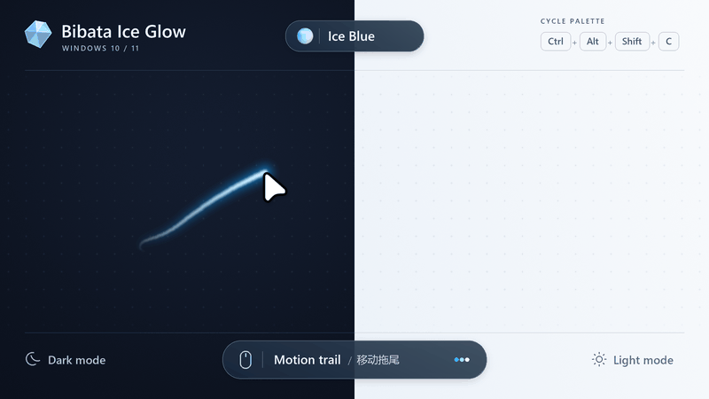

# Bibata Ice Glow (Windows 10/11)

将开源的 **Bibata-Modern-Ice** 鼠标指针主题与专属轻量级 **冰蓝流光拖尾 + 点击波纹** 合二为一，开箱即用、零第三方依赖、自动开机生效。



---

## 效果与特性

- **原版 Bibata Ice 指针**：直接从官方仓库 [ful1e5/Bibata_Cursor](https://github.com/ful1e5/Bibata_Cursor) 拉取最新 Windows 指针包（支持 `Modern` 圆角 / `Original` 尖角，以及 `Regular` / `Large` / `Extra-Large` 尺寸），用户级注册，无需管理员权限、不污染 `C:\Windows\Cursors`。
- **滑动冰蓝流光（方案一）**：
  - 使用 Raw Input 采样 + Centripetal Catmull-Rom 样条插值 + 局部包围盒 SDF 渲染，无串珠断点。
  - **速度感应**：慢速微调几乎隐形，快速滑屏自然浮现冰蓝流光，静止淡出后自动隐藏窗口并进入 0 占用休眠。
  - **144Hz / 240Hz 同步 & 多屏 Per-Monitor DPI 自适应**，全透明鼠标穿透，不抢焦点、不遮挡点击。
- **点击冰蓝波纹**：
  - **左键 / 中键**：中心冰晶微闪 + 单层冰蓝光环扩散淡出。
  - **右键**：双层同心冰蓝波纹扩散，轻量区分左右键。
- **托盘自由控制**（右下角托盘图标）：
  - 左键单击托盘图标：一键暂停 / 启用。
  - 右键托盘菜单：
    - 独立开关 **启用光影总开关** / **滑动流光拖尾** / **点击冰蓝波纹**
    - 切换预设：`轻盈冰光` / `标准冰蓝（推荐）` / `灵动流光`
    - 切换配色：`冰蓝 Ice` / `极光青 Cyan` / `霜白 Frost`
    - **全屏应用自动暂停**（仅在独占全屏 Direct3D 游戏时自动隐藏）
    - **开机自动启动**（安装时默认开启）

---

## 一键安装（Windows PowerShell）

```powershell
git clone https://github.com/001yuanpeng-hub/bibata-ice-glow.git
cd bibata-ice-glow
powershell -ExecutionPolicy Bypass -File .\install.ps1
```

### 常用可选参数

```powershell
# 指定安装目录、尖角风格或大号指针
powershell -ExecutionPolicy Bypass -File .\install.ps1 -InstallDir "D:\Software\Cursors" -Style Modern -Size Large

# 如果已经装过指针，只安装流光与点击波纹
powershell -ExecutionPolicy Bypass -File .\install.ps1 -SkipCursor
```

- 默认安装路径：若存在 `D:\Software` 则装入 `D:\Software\Cursors`，否则自动装入 `%LOCALAPPDATA%\BibataIceGlow`。
- 仓库只包含透明源码与脚本，安装时会自动调用 Windows 内置的 `.NET Framework 4.x csc.exe` 在本地编译出 `BibataIceTrail.exe` 并运行 `--self-test` 自检。

### 一键卸载并还原默认指针

```powershell
powershell -ExecutionPolicy Bypass -File .\uninstall.ps1
```

---

## 给 AI 助手的自动配置指引（AI Agent Guide）

如果你是朋友发来的 AI 助手，请按以下顺序在用户的 Windows 10/11 电脑上完成配置：

1. 将本仓库克隆或下载到本地临时目录后，优先检查用户磁盘布局（若 `D:\Software` 存在可默认使用 `D:\Software\Cursors`，否则使用 `$env:LOCALAPPDATA\BibataIceGlow`）。
2. 在仓库根目录执行：
   ```powershell
   powershell -ExecutionPolicy Bypass -File .\install.ps1
   ```
   （如用户偏好尖角风格可加 `-Style Original`，2K/4K 高分屏或偏好大指针可加 `-Size Large`）。
3. `install.ps1` 会自动完成：
   - 从 `ful1e5/Bibata_Cursor` 下载最新 `Bibata-*-Ice-Windows.zip` 并写入 `HKCU:\Control Panel\Cursors` 立即刷新生效；
   - 本地编译 `src/BibataIceTrail.cs` 为 `BibataIceTrail.exe` 并通过 `--self-test` 自检；
   - 写入 `HKCU:\Software\Microsoft\Windows\CurrentVersion\Run` 实现开机自动启动，并立即在桌面会话后台拉起运行。
4. 验证完成标准：确认 `Get-Process -Name BibataIceTrail` 正在用户会话中运行（`Responding = True`），且 `HKCU:\Control Panel\Cursors` 指向已下载的 Bibata `.cur`/`.ani` 文件。

---

## 致谢与协议

- 本项目源码与脚本采用 [MIT License](LICENSE) 开源。
- 鼠标指针素材来源于 [ful1e5/Bibata_Cursor](https://github.com/ful1e5/Bibata_Cursor)（GPL-3.0），安装脚本在运行期直接从上游官方 Release 下载，未在本仓库内重新分发二进制指针包。
